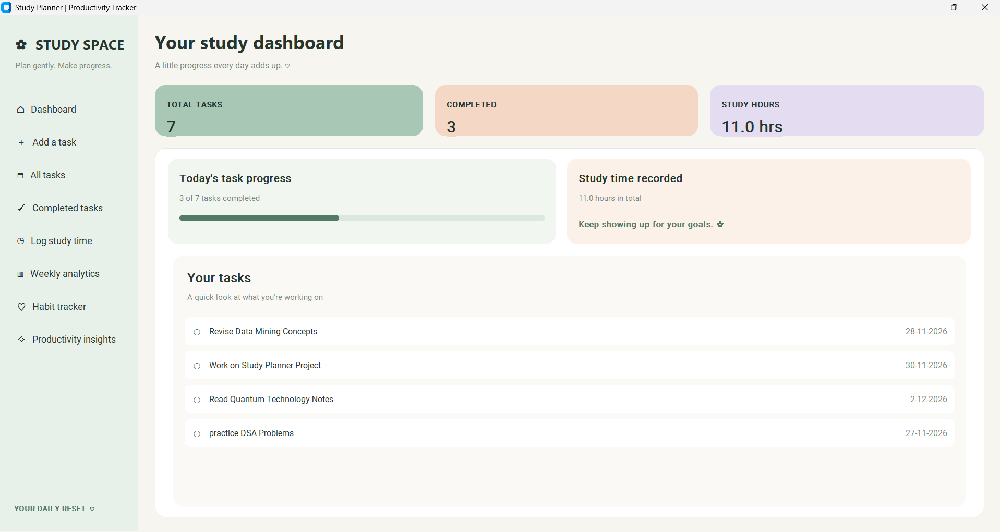
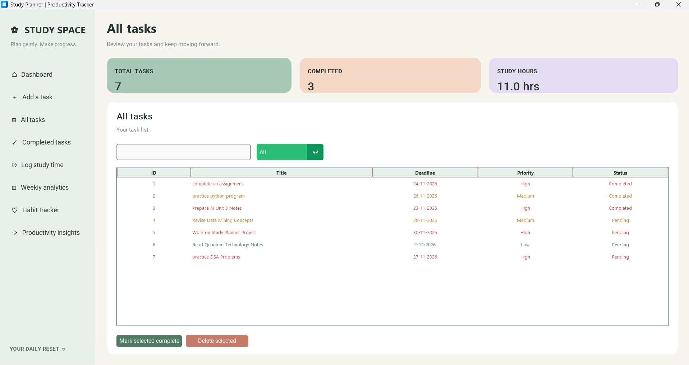
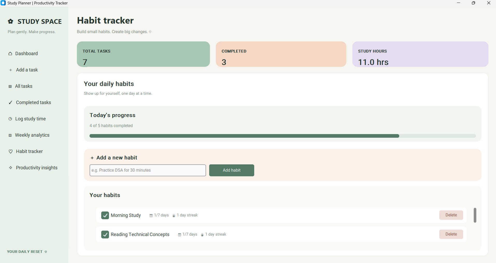
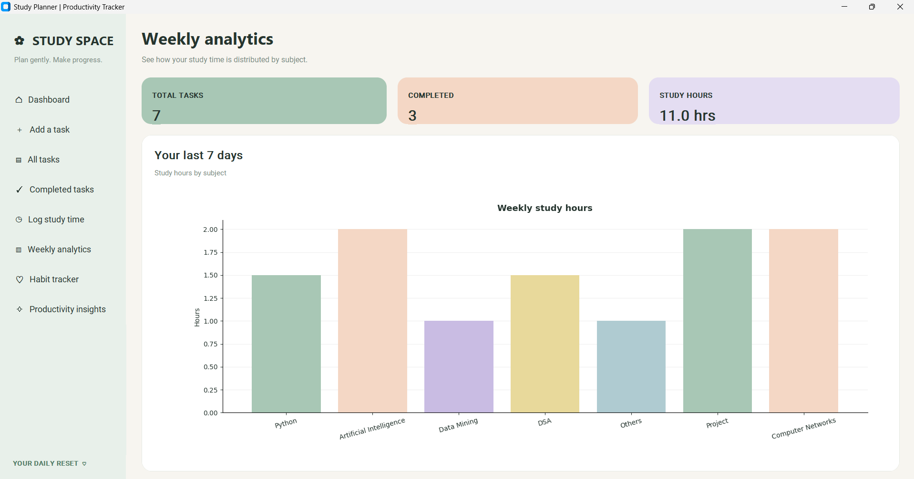
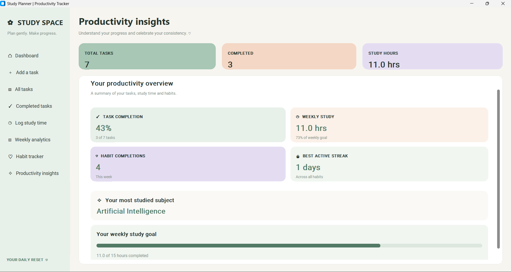

# Personal Study Planner and Productivity Analytics Tool

A Python-based desktop application designed to help students organize academic tasks, manage deadlines, track study hours, build consistent habits, and understand their productivity through visual analytics.

## Application Screenshots

### 1. Dashboard
Get an overview of tasks, study progress, and productivity at a glance.



### 2. All Tasks
Manage academic tasks, deadlines, priorities, and completion status.



### 3. Habit Tracker
Build consistent daily routines and monitor habit completion and streaks.



### 4. Weekly Analytics
Visualize study activity and compare study hours across subjects.



### 5. Productivity Insights
Review productivity statistics, task completion, habit progress, and weekly study goals.



## Features

### 1. Task Management
- Add study tasks with deadlines.
- View pending and completed tasks.
- Mark tasks as completed.
- Delete tasks.
- Assign priorities: High, Medium, and Low.
- Search and filter tasks.

### 2. Study Time Tracking
- Log study hours by subject or category.
- Maintain a record of study sessions.
- Monitor total study hours.

### 3. Habit Tracker
- Track daily habits.
- Mark habits as completed.
- Monitor weekly habit completion.
- Track habit streaks.

### 4. Productivity Analytics
- View total and completed tasks.
- Monitor weekly study hours.
- Track progress toward a weekly study-hour goal.
- Analyze habit completion.
- Identify the most studied subject.
- Visualize study activity through charts.

### 5. Dashboard
- View important productivity statistics.
- Monitor task completion progress.
- View study-hour summaries.
- Access productivity insights.

## Technologies Used

| Technology | Purpose |
|---|---|
| Python | Core programming language |
| CustomTkinter | Desktop graphical user interface |
| Matplotlib | Charts and data visualization |
| JSON | Task and habit data storage |
| CSV | Study-time records |

## Project Structure

```text
Personal Study Planner/
│
├── screenshots/
│   ├── dashboard.png
│   ├── all-tasks.png
│   ├── habit-tracker.png
│   ├── weekly-analytics.png
│   └── productivity-insights.png
│
├── study_planner_ctk.py
├── requirements.txt
├── README.md
└── .gitignore
```

Personal application data files are stored locally and excluded from GitHub.

## Installation and Setup

### 1. Clone the repository

```bash
git clone https://github.com/sravya2130/personal-study-planner-productivity-analytics.git
```

### 2. Navigate to the project directory

```bash
cd personal-study-planner-productivity-analytics
```

### 3. Install dependencies

```bash
pip install -r requirements.txt
```

### 4. Run the application

On Windows:

```powershell
py study_planner_ctk.py
```

Alternatively:

```bash
python study_planner_ctk.py
```

## Project Objective

The objective of this project is to provide students with an organized platform to manage academic tasks, track study time, build consistent habits, and understand their productivity through visual analytics.

## Future Enhancements

- Add reminders and notifications for upcoming deadlines.
- Introduce monthly and yearly productivity reports.
- Add more detailed subject-wise analytics.
- Export productivity reports.

## Developed By

**SREERAM JHANSI LAKSHMI SRAVYANJALI**

B.Tech – Computer Science and Engineering

GitHub: [@sravya2130](https://github.com/sravya2130)
